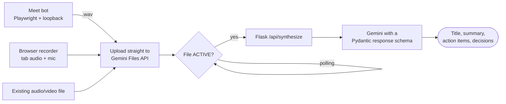

<p align="center">
  
</p>

<p align="center">
  
  
  
  
  
</p>

Auto-MOM (Minutes of Meeting) turns a meeting recording into clean minutes. Record the call
in the browser, upload an audio or video file, or let a Playwright bot sit in your Google Meet
and record it for you. Gemini then listens to the audio and returns a title, summary, action
items and key decisions as structured JSON.

## How it works



- **Two ways to capture a call.** The web app asks to share a tab or screen, mixes its audio
  with your microphone through an `AudioContext` and records it with `MediaRecorder`. The
  optional bot (`bot_engine.py`) opens Chrome, joins the Meet with mic and camera off, records
  system audio to `meeting_recording.wav` and leaves once it is the only one left.
- **Large files skip the server.** The browser uploads media directly to the Gemini Files API
  and polls until the file is `ACTIVE`, so the serverless backend only handles a small JSON
  request and stays within its time limit.
- **Output is structured.** The backend passes a Pydantic `MeetingMinutes` model as Gemini's
  response schema, so the reply is JSON with `title`, `date`, `summary`, `actionItems` and
  `decisions`.
- **Models fall back automatically.** A resolver lists the Gemini models your key can use,
  ranks them, and moves to the next one on a 429 or 503 (quota or availability) error.
- **Pro and Fast modes.** A toggle switches between a Pro and a Flash Lite model. Settings, an
  optional personal API key and a client-side rate-limit counter are kept in `localStorage`.
- **Keep a copy.** A browser recording can be saved to your device as a `.webm` file.

## Quick start

You need a [Gemini API key](https://aistudio.google.com/apikey), Python 3 and Node.js.

```bash
git clone https://github.com/NamanSingh69/Auto-MOM.git
cd Auto-MOM

# Backend (Flask on http://localhost:5000)
python -m venv .venv && source .venv/bin/activate   # Windows: .venv\Scripts\activate
pip install -r api/requirements.txt
export GEMINI_API_KEY=...        # server-side key, used when the browser sends none
python api/index.py

# Frontend (Vite dev server, in a second terminal)
cd frontend
npm install
npm run dev
```

Open the URL Vite prints, add your Gemini key in **Settings** (the browser uses it for the
direct upload), then record or upload a meeting and click **Synthesize**.

**Optional Meet bot** (Windows recommended, since it records WASAPI loopback audio; needs
Google Chrome installed):

```bash
pip install playwright soundcard soundfile numpy
python bot_engine.py             # paste the Meet URL when prompted
```

On first run, sign in to Google in the browser window that opens and press Enter; the session
is kept in `./bot_profile`. Upload the resulting `meeting_recording.wav` in the web app.

## API

All endpoints accept an optional `X-Gemini-Key` header and fall back to `GEMINI_API_KEY`.

| Method | Path | What it does |
|---|---|---|
| `POST` | `/api/synthesize` | Generates minutes. JSON body `{"file_uri": "...", "file_name": "files/...", "model": "..."}` for a file already uploaded to Gemini, or multipart with a `media`/`audio` file for small uploads |
| `GET` | `/api/models` | Returns the ranked model cascade for the key |
| `GET` | `/api/health` | Health check |

## Project layout

```
frontend/                     React 19 + TypeScript + Vite app (recorder, upload, results UI)
api/index.py                  Flask API: synthesis endpoint and Gemini calls
api/gemini_model_resolver.py  model discovery, ranking and 429/503 fallback
api/test_gemini_resolver.py   pytest unit tests for model scoring and fallback (Gemini mocked)
bot_engine.py                 Playwright Google Meet bot with system-audio recording
vercel.json                   Vercel build and routing config
```

## Deploy

`vercel.json` builds `frontend/` as a static site and runs `api/index.py` as a Python
serverless function, routing `/api/*` to it. Set `GEMINI_API_KEY` in the Vercel project
settings. The Meet bot runs locally and is not part of the deployment.
